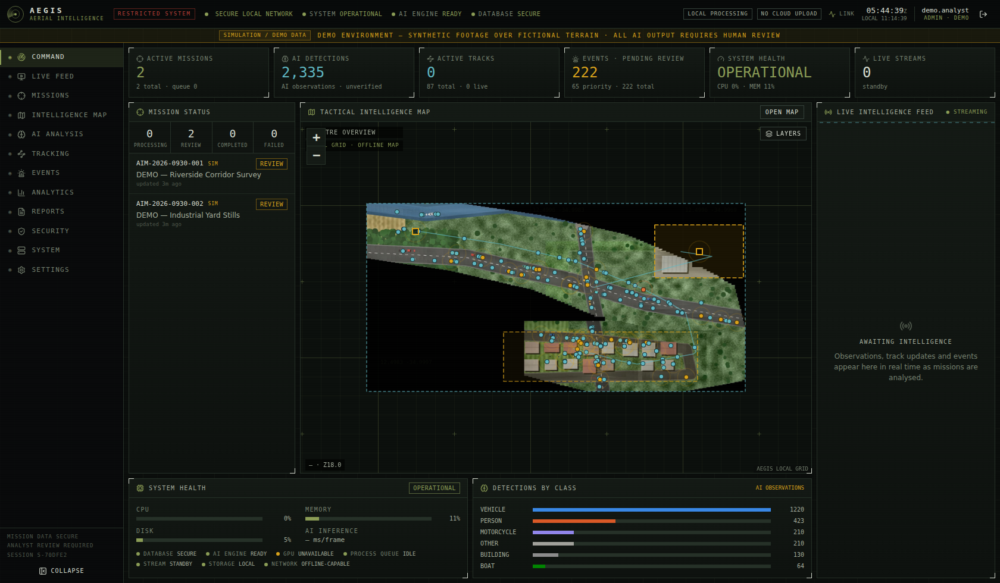
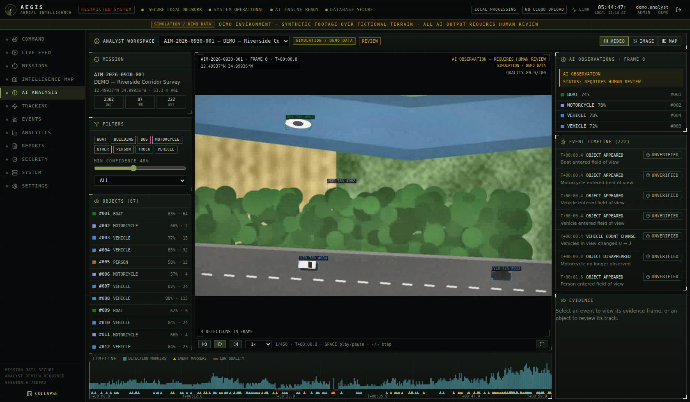
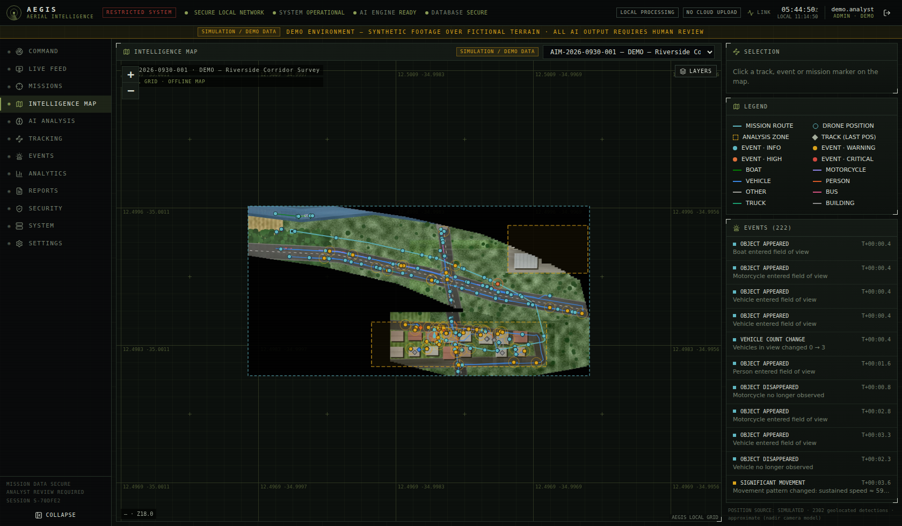
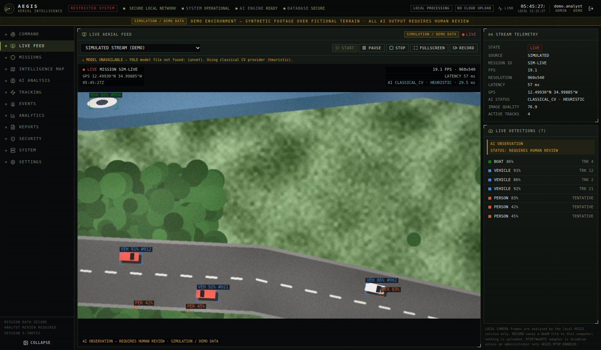
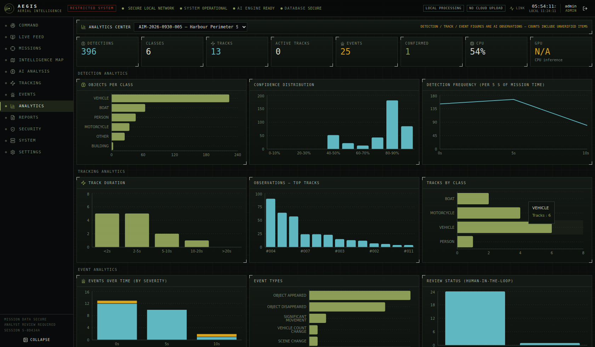
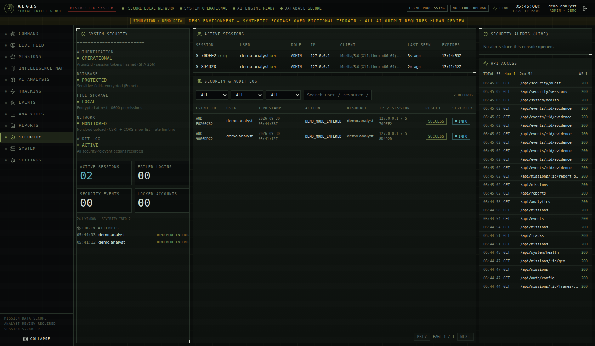

# AEGIS AERIAL INTELLIGENCE

**AI-powered aerial mission intelligence & geospatial analysis — Mission Analysis System**

AEGIS is a local-first, security-first **defensive monitoring, intelligence-analysis, visualisation and
decision-support platform** for drone imagery. It ingests drone video and stills, runs a local computer-vision
pipeline (preprocessing → detection → tracking → scene analysis → event analysis → geospatial analysis), and
presents the results in a command-centre UI where **human analysts review every AI observation** before it is
reported.

> **Scope boundary.** AEGIS contains no weapon control, target engagement, fire control, guidance, autonomous
> targeting, or any platform/drone-control capability. The live feed is observation-only. Every AI output is
> labelled *AI OBSERVATION — REQUIRES HUMAN REVIEW*.
>
> The interface uses fictional labels (RESTRICTED SYSTEM, LOCAL PROCESSING …) and claims no affiliation with any
> government or military organisation.

| Command center | Analyst workspace | Intelligence map |
|---|---|---|
|  |  |  |
| **Live aerial feed** | **Analytics** | **Security & audit** |
|  |  |  |

---

## Quick start

| Mode | Command | URL |
|---|---|---|
| **Offline demo** (single process, no internet needed) | `./scripts/demo.sh` | http://127.0.0.1:8000 → **ENTER DEMO MODE** |
| **Local development** (API with reload + Vite HMR) | `./scripts/dev.sh` | http://127.0.0.1:5173 |
| **Production (Docker)** | `cp .env.example .env` → edit → `docker compose up -d --build` | http://127.0.0.1:8000 |
| **Offline demo (Docker)** | `docker compose --profile demo up --build aegis-demo` | http://127.0.0.1:8080 |
| **Tests** | `./scripts/test.sh` | — |

### Prerequisites (non-Docker)

- Python 3.11+, Node 20+ (Node 22 recommended), `ffmpeg`/`ffprobe` optional (richer video metadata)
- ```bash
  pip install -r backend/requirements-dev.txt
  (cd frontend && npm ci)
  ```

### First sign-in

On first start with an empty database an administrator is created:

- username: `AEGIS_BOOTSTRAP_ADMIN_USER` (default `admin`)
- password: `AEGIS_BOOTSTRAP_ADMIN_PASSWORD`, or — if unset — a random password written to
  `$AEGIS_DATA_DIR/.keys/bootstrap_admin_password.txt` (mode 0600). Change it under **SETTINGS → CHANGE PASSWORD**.

**ENTER DEMO MODE** (login screen) opens a sandboxed demo account. On first entry AEGIS renders ~60 s of synthetic
aerial footage plus three EXIF-geotagged stills over **fictional terrain positioned in open ocean (12.5°N 35°W)** and
processes them through the real pipeline; a sample PDF report is generated automatically. All demo content is marked
**SIMULATION / DEMO DATA**. Demo accounts only see demo missions and cannot manage users or change settings.

---

## Demonstration workflow

`LOGIN → SECURE COMMAND CENTER → CREATE MISSION → UPLOAD DRONE VIDEO → INGESTION → PREPROCESSING → AI DETECTION →
OBJECT TRACKING → SCENE ANALYSIS → EVENT ANALYSIS → GEO-SPATIAL ANALYSIS → HUMAN REVIEW → ANALYTICS → MISSION REPORT →
AUDIT LOG`

1. Sign in (or ENTER DEMO MODE). The **COMMAND** view shows live mission state, KPIs, the tactical map and the live
   intelligence feed (WebSocket).
2. **MISSIONS → CREATE MISSION** — the ID `AIM-YYYY-MMDD-NNN` is generated server-side.
3. Drag & drop MP4/AVI/MOV/JPG/JPEG/PNG/WEBP files. Each file is size-capped, extension- and magic-byte-checked,
   decode-verified, metadata/GPS-extracted, hashed (SHA-256) and stored **encrypted** under a server-generated name.
4. **RUN AI ANALYSIS** — the 10-stage pipeline is shown live (DRONE DATA → … → REPORT).
5. **AI ANALYSIS** (analyst workspace) — frame player with overlays, still view with quality/scene metrics, map view;
   object list & filters (left), AI observations / event timeline / evidence (right), timeline with detection and
   event markers (bottom). Clicking an event jumps to its evidence frame.
6. Record **CONFIRMED / REJECTED / NEEDS REVIEW / UNVERIFIED** plus notes on events and tracks.
7. **ANALYTICS**, **INTELLIGENCE MAP**, **TRACKING**, **EVENTS** for exploration.
8. **REPORTS** — export PDF / JSON / CSV (each carries *AI-GENERATED / REQUIRES HUMAN REVIEW*).
9. **SECURITY** — every step above appears in the audit log.

---

## Architecture

```
frontend/  React 18 · TypeScript · Vite · Tailwind v4 · Lucide · Recharts · Leaflet
  src/components   Shell (header/nav), TacticalMap (offline grid basemap + layers), PipelineView,
                   FramePlayer, Timeline, IntelFeed, ReviewControls, ui primitives
  src/pages        Login, Command, LiveFeed, Missions, IntelMap, Analysis, Tracking, Events,
                   Analytics, Reports, Security, System, Settings
  src/lib          api (CSRF, structured errors, XHR upload progress), auth, feed (WebSocket), hooks

backend/   FastAPI · Pydantic v2 · SQLAlchemy 2 · OpenCV · NumPy · ReportLab
  app/main.py            app, lifespan bootstrap, error handlers, SPA serving
  app/config.py          env-driven settings (AEGIS_*)
  app/models.py          users, sessions, missions, media, frames, detections, tracks, events,
                         locations, reports, audit_logs, ai_models, system_events (+ app_settings)
  app/security.py        Argon2id, opaque session tokens (SHA-256 at rest), RBAC, CSRF, rate limiting
  app/crypto.py          Fernet encryption at rest (files + EncryptedText columns)
  app/deps.py            zero-trust request context: every request re-authenticated & authorised
  app/audit.py           audit records + security events (pushed to admins over WebSocket)
  app/middleware.py      request IDs, security headers/CSP, request logging, API access stats
  app/routers/           auth, users, missions(+media, pipeline, frames), intel (tracks/events/review),
                         geo, analytics(+dashboard), reports, security_center, system, ws
  app/cv/                preprocess, detectors (provider abstraction), tracking (tracker abstraction),
                         scene, events (rule engine), geo (camera model, visual odometry, mosaic), synthetic
  app/services/          ingest, pipeline (worker + orchestration), reports, live, metrics, demo, frames
```

### AI pipeline

| Stage | Implementation |
|---|---|
| INGESTION | allow-list + magic bytes + decode check; ffprobe/OpenCV metadata; EXIF & ISO-6709 GPS |
| PREPROCESS | resize/normalise, bilateral denoise, CLAHE contrast, brightness correction, auto low-light gamma, dark-channel de-haze, quality score (sharpness, brightness, contrast, noise, haze) |
| AI DETECT | `DetectorProvider` interface. **`YoloOnnxDetector`** (YOLOv5/v8 ONNX via OpenCV DNN, COCO→AEGIS class map, NMS) when a local model is configured; otherwise **`ClassicalCVDetector`** (robust median/MAD local-anomaly blobs + motion-compensated difference cue + ground-sampling-distance size priors + road-marking/vegetation suppression). Missing model ⇒ explicit *MODEL UNAVAILABLE* notice, never silent. |
| TRACKING | `TrackerProvider` interface; built-in **SORT-lite** (constant-velocity prediction, greedy IoU/distance association in camera-motion-compensated coordinates, class voting, min-hits confirmation). ByteTrack/SORT/DeepSORT adapters register in `TRACKERS`. |
| SCENE AI | colour/texture/structure indicators → URBAN, RURAL, FOREST, ROAD, INDUSTRIAL, AGRICULTURAL, WATER, MOUNTAIN, OPEN TERRAIN with confidence, building density, road presence, vegetation, water |
| EVENT AI | configurable rules: OBJECT APPEARED/DISAPPEARED, SIGNIFICANT MOVEMENT, SCENE CHANGE, VEHICLE COUNT CHANGE, CROWD DENSITY CHANGE, MONITORING ZONE ENTRY/EXIT, VIDEO INTERRUPTION (frozen/black/read errors), LOW IMAGE QUALITY — each with annotated evidence frame |
| GEO ANALYSIS | nadir camera model (altitude + HFOV → GSD), phase-correlation visual odometry anchored to GPS/declared origin, per-detection geolocation, route, translation mosaic overlay |
| INTELLIGENCE / REPORT | summaries, statistics, report data |

Quality-aware gating raises the detection threshold on degraded frames. With the built-in classical provider the
assurance level is shown as **HEURISTIC**; install a YOLO ONNX model for production-grade detection:

```bash
# Place a locally obtained model (respect its licence) in the data directory — nothing is downloaded.
cp yolov8n.onnx data/models/
export AEGIS_YOLO_MODEL_PATH=$PWD/data/models/yolov8n.onnx
```

### Live aerial feed

WebSocket `/ws/live`: **SIMULATED STREAM** (synthetic demo world), **LOCAL VIDEO** (a mission video replayed as a
stream), **LOCAL CAMERA** (browser camera frames analysed by the local service only) and an **RTSP adapter** that is
disabled unless `AEGIS_RTSP_ENABLED=true`. HUD: LIVE, mission ID, FPS, resolution, latency, timestamp, GPS, AI status.
Controls: START, PAUSE, STOP, FULLSCREEN, RECORD (saved locally as WebM). No control commands exist.

---

## Security architecture

- **Zero trust** — every API call and WebSocket connection re-validates the session, account state and permission;
  resources are always resolved server-side by ID and checked against the caller (demo accounts are sandboxed).
- **Authentication** — Argon2id hashing, timing-equalised login, generic failure messages, failed-login tracking and
  lockout (`AEGIS_MAX_FAILED_LOGINS`, `AEGIS_LOCKOUT_MINUTES`), rate limiting, absolute + idle session expiry, logout
  revocation. Session tokens are random 256-bit values stored only as SHA-256 digests; cookies are
  `HttpOnly; SameSite=Strict` (`Secure` behind TLS).
- **CSRF** — double-submit token (header must match the per-session token) on every cookie-authenticated state change.
  Bearer tokens are also accepted for API clients.
- **RBAC** — ADMIN · ANALYST · OPERATOR · VIEWER (matrix in `app/security.py`).
- **Data protection** — local-first; nothing is uploaded to any cloud service. Media, keyframes, evidence frames,
  mosaics and reports are Fernet-encrypted at rest with 0600 permissions; mission notes and analyst notes are
  encrypted columns. Client filenames are never used for paths (UUID names, strict path validation).
- **Uploads** — extension allow-list, magic-byte verification, streaming size cap, decode verification; rejections
  are audited.
- **API** — Pydantic validation with `extra=forbid`, structured errors `{"error": {code, message, request_id}}`,
  request logging, CSP / X-Frame-Options / nosniff / Referrer-Policy / COOP headers, CORS allow-list, WebSocket
  Origin checks (anti-hijacking), OpenAPI docs disabled in production.
- **Maps** — the default basemap is a locally rendered tactical grid plus mission imagery mosaics; online tiles are
  opt-in (`AEGIS_ONLINE_TILES_ENABLED`) because they disclose the area of interest to a third party.
- **Audit** — logins, failures, lockouts, sessions, uploads, mission changes, pipeline runs, reviews, report
  generation/download, configuration changes, permission denials, CSRF failures and API errors. Records carry
  EVENT ID, USER, TIMESTAMP, ACTION, RESOURCE, IP / SESSION reference, RESULT, SEVERITY — never secrets.

Error conditions surfaced to users: INVALID FILE, CORRUPTED VIDEO, MODEL UNAVAILABLE, GPU UNAVAILABLE, DATABASE
FAILURE, STREAM DISCONNECTED, PROCESSING FAILURE, INVALID GPS, PERMISSION DENIED, SESSION EXPIRED.

---

## Configuration

All settings are `AEGIS_*` environment variables — see [`.env.example`](.env.example). Key ones:

| Variable | Purpose |
|---|---|
| `AEGIS_ENV` | `development` / `production` (production hides API docs) |
| `AEGIS_DATA_DIR` | local storage root (db, encrypted media, frames, reports, keys) |
| `AEGIS_DATABASE_URL` | SQLAlchemy URL — SQLite by default; PostgreSQL supported (`postgresql+psycopg://…`, add `psycopg[binary]`) |
| `AEGIS_ENCRYPTION_KEY` | Fernet key for encryption at rest (**set and back up in production**) |
| `AEGIS_BOOTSTRAP_ADMIN_PASSWORD` | initial admin password |
| `AEGIS_COOKIE_SECURE` | `true` behind HTTPS |
| `AEGIS_DEMO_MODE_ENABLED` | show ENTER DEMO MODE |
| `AEGIS_YOLO_MODEL_PATH` | local YOLO ONNX model |
| `AEGIS_MAX_UPLOAD_MB` | upload cap |
| `AEGIS_RTSP_ENABLED` / `AEGIS_ONLINE_TILES_ENABLED` | opt-in adapters |

Runtime analysis settings (confidence threshold, enabled classes, frame stride, camera FOV, preprocessing toggles,
event rules and thresholds) are editable by admins under **SETTINGS** and are audited.

---

## Testing

```bash
./scripts/test.sh          # both suites
cd backend && python -m pytest -q
cd frontend && npm test
```

- **Backend (pytest, 89 tests)** — authentication, lockout, rate limiting, session expiry/revocation, CSRF, RBAC,
  mission creation & validation, encryption at rest, uploads (unsupported type, spoofed magic bytes, corrupted video,
  oversize, path-traversal filenames, EXIF GPS), full pipeline run, frames/evidence, tracks/events/review, geo,
  analytics, report generation (PDF/JSON/CSV + hash check), security center, settings, users, system health,
  unauthorised access to every protected endpoint, permission violations, malformed requests, demo sandboxing,
  path traversal helpers, security headers, detector accuracy on synthetic ground truth, YOLO tensor parsing, tracker
  identity & motion compensation, event rules, scene classification, geo helpers, visual odometry.
- **Frontend (Vitest + Testing Library)** — auth gate & login errors, dashboard from API state, navigation & role
  gating, mission form validation, upload validation UI, pipeline stages, AI-observation framing, map mounting &
  popup escaping, report center.

---

## Deployment notes

- Single-worker Uvicorn by design: the pipeline worker, WebSocket hub and in-memory rate limiter live in-process.
  For multi-node deployments move rate limiting to Redis and the pipeline to a job queue.
- Put a TLS reverse proxy in front (set `AEGIS_COOKIE_SECURE=true`); compose binds to `127.0.0.1` by default and runs
  the container read-only, non-root, with all capabilities dropped.
- Back up `$AEGIS_DATA_DIR` **and** the encryption key separately.
- GPU: the classical provider runs on CPU; YOLO inference uses OpenCV DNN on CPU unless an OpenCV CUDA build is
  installed (reported under SYSTEM → GPU).

## Limitations (honest assurance statement)

- The built-in classical detector is a heuristic suited to the demo imagery and to nadir footage with clear object
  contrast. Expect false positives/negatives on real footage; use a validated YOLO model and keep human review.
- Geolocation assumes a nadir, north-up camera with the configured FOV and altitude; positions are approximate.
- Scene classification is rule-based and indicative only.
